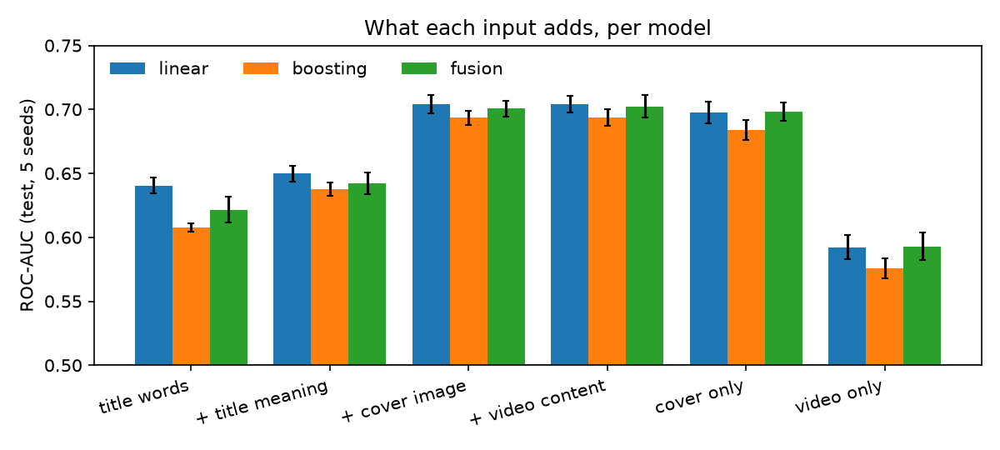
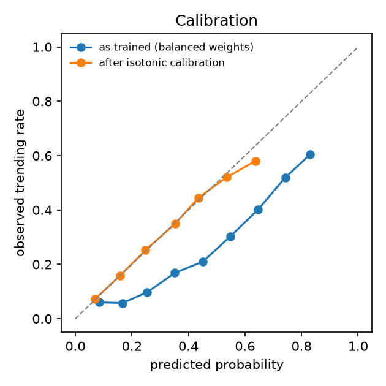
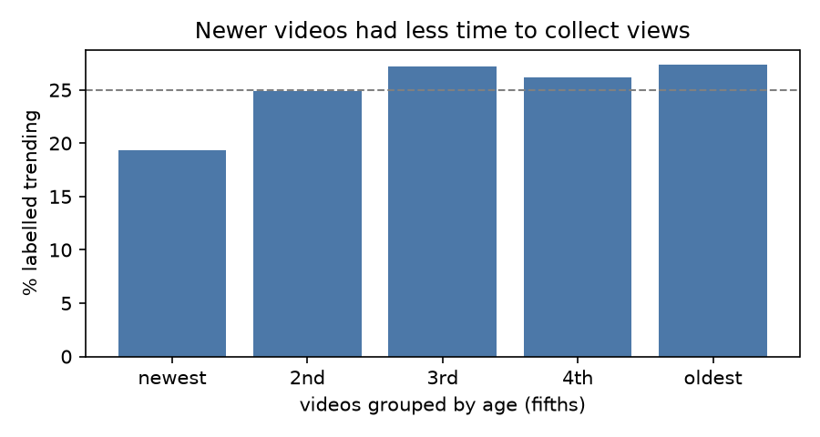

# Passioné v2: does a micro-video's content predict whether it trends?

Passioné v1 predicts film popularity from metadata. v2 asks what a short video's **content** adds: its title, its
cover image and the video itself. Data: 19,738 real micro-videos with real view counts from
[MicroLens-100k](https://github.com/westlake-repl/MicroLens) (Westlake University).

**Label:** trending = top 25% by views (above 2,148,000 views). Likes and comments are never features: they come
after the views, so they would leak the answer.

## Findings

1. **The cover image carries the visual signal.** Adding a CLIP embedding of the cover lifts ROC-AUC by
   **+0.054** (95% interval +0.048 to +0.060) on top of the title, for every model and both label definitions.
2. **The video itself adds nothing on top of the cover.** VideoMAE's gain is +0.000 (interval -0.001 to +0.002).
   Alone, the video reaches only 0.59. On short-video apps a viewer decides from the cover and title before the
   video plays, which fits.
3. **The title's meaning helps a little.** BGE-M3 adds +0.009 to +0.030 over title words, depending on the model.
4. **A linear model is enough.** Tuned gradient boosting is *worse* than logistic regression (-0.010, interval
   -0.015 to -0.006), and a PyTorch fusion network matches it (-0.002, not significant). With 16k training videos
   and frozen embeddings, there is no non-linear signal left for a bigger model to find.
5. **The label is mostly fair.** Age alone predicts it at ROC-AUC 0.54. The newest fifth of videos (median 15 days
   online) is under-labelled (19% trending, against 25 to 27%), so every result was also checked on an
   age-adjusted label (top 25% within each age fifth). All findings hold.
6. **Scores can be made into honest probabilities.** Balanced class weights push raw scores up (mean 0.46 against a
   25% base rate). Isotonic calibration cuts the expected calibration error from **0.211 to 0.009**.
7. **Most "confident mistakes" are near the cut-off.** Within a factor of 1.4 of the cut-off the model is at chance
   (ROC-AUC 0.52). The most confident false positive has 2,111,573 views, 1.7% under the line. As a ranking, the
   score correlates with log views at Spearman 0.43.



## Method

| Step | What | Why |
|:--|:--|:--|
| Age check | First logged interaction as a proxy for upload time; trending rate by age fifth | Older videos have had longer to collect views |
| Features | TF-IDF title words; BGE-M3 title, CLIP RN50 cover and VideoMAE video embeddings (the dataset authors' features) | One block per modality, so each can be added or removed |
| Models | Class-weighted logistic regression (early fusion); histogram gradient boosting on PCA-reduced blocks; a PyTorch network with one encoder per modality, a shared head and modality dropout (intermediate fusion) | Tests whether non-linear interactions between modalities matter |
| Tuning | Grid search on inner validation splits of the training rows only (`tune.py`) | The test rows never influence a setting |
| Evaluation | Stratified 80/20 split, 5 seeds; every model scored on the same rows per seed | Paired comparisons |
| Uncertainty | Paired bootstrap of the ROC-AUC gain, 2,000 resamples per seed, averaged over seeds | "Does X help" becomes a measured interval, not a guess |
| Calibration | Expected calibration error, Brier score, reliability curve; isotonic regression cross-fitted on the test rows | No row is scored by a calibrator that saw it |
| Errors | ROC-AUC by age, title length and distance from the cut-off; most confident mistakes | Where and why it fails |

## Results

ROC-AUC on the test rows, mean ± standard deviation over 5 seeds (raw label):

| Features | Linear | Boosting | Fusion network |
|:--|--:|--:|--:|
| Title words (TF-IDF) | **0.640** ± 0.006 | 0.608 ± 0.003 | 0.622 ± 0.010 |
| + title meaning (BGE-M3) | **0.650** ± 0.006 | 0.638 ± 0.005 | 0.642 ± 0.008 |
| + cover image (CLIP) | **0.704** ± 0.007 | 0.693 ± 0.006 | 0.701 ± 0.006 |
| + video content (VideoMAE) | **0.704** ± 0.007 | 0.694 ± 0.007 | 0.702 ± 0.009 |
| Cover only | 0.698 ± 0.008 | 0.684 ± 0.008 | 0.698 ± 0.007 |
| Video only | 0.592 ± 0.009 | 0.576 ± 0.008 | 0.593 ± 0.011 |

Full tables (both labels, every paired comparison, calibration and error slices):
[`results/phase1.md`](results/phase1.md). Machine-readable: `results/phase1.json`.

| Calibration | Before | After isotonic |
|:--|--:|--:|
| Expected calibration error | 0.211 | 0.009 |
| Brier score | 0.215 | 0.170 |

<p> </p>

## Limits

- The embeddings are the dataset authors' pre-extracted features: CLIP RN50 is an older image model, and VideoMAE
  saw a fixed sample of frames. Better encoders might change finding 2.
- Upload time is estimated from the first logged interaction of a 100k-user sample, so it is a lower bound.
- A hard top-25% cut-off makes videos near it coin flips. Predicting log views directly, or ranking, would use the
  data better.

Next: extract our own cover and frame embeddings with current models, on a streamed subset of the raw videos.

## Run it

```bash
uv sync                             # Python 3.12, PyTorch (uses the Apple GPU when present)
uv run python fetch_microlens.py    # labels, titles, interaction log and three embedding matrices, about 230 MB
uv run python tune.py               # optional: re-tune the non-linear models on training rows (results/tuned.json)
uv run python study.py              # 150 runs: 2 labels x 3 models x feature sets x 5 seeds (resumable)
uv run python analyze.py            # tables, paired intervals, calibration, errors, figures
```

| File | Role |
|:--|:--|
| `common.py` | Loading, the two labels, splits, feature blocks (fit on training rows only) |
| `models.py` | Linear, boosting and the PyTorch fusion network |
| `tune.py` | Settings for the non-linear models, chosen on training rows |
| `study.py` | Runs every combination and saves predictions |
| `analyze.py` | Paired bootstrap, calibration, error analysis, report and figures |
| `passione_v2.py` | The original single-model script (its numbers are the "Linear" column) |

`fetch_microlens.py` pulls only the needed files out of the authors' 684 MB feature archive with HTTP range requests.
The data stays out of git (`data/` is ignored): the authors ask that modified copies are not redistributed.

Citation: Ni et al., "A Content-Driven Micro-Video Recommendation Dataset at Scale".
